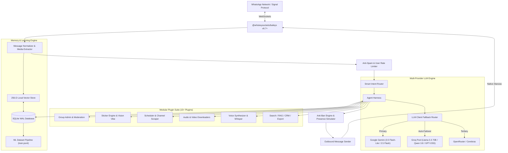

# Forgelabs Assistant 🤖

[](https://nodejs.org)
[](https://www.typescriptlang.org)
[](https://github.com/WhiskeySockets/Baileys)
[](https://ai.google.dev/)
[](https://groq.com)
[](https://sqlite.org)
[](LICENSE)

> *"This is Forgelabs Assistant — an Agentic WhatsApp Bot. I was inspired to build this by my bro **Micah Okoh**, and my other bro **Adeniran Glory**. We're going places guys! 🚀"*  
> — **Ademola** (*Aspiring ML/AI Engineer*)

**Forgelabs Assistant** is a modular, continuous-learning WhatsApp AI agent designed for high availability, humanlike conversational intelligence, and multimedia automation. It combines the speed and flexibility of modern agentic tool routing with strict anti-ban human behavior emulation, persistent vector and relational memory, and an end-to-end machine learning data generation pipeline.

---

## 🏛️ Framework & Architectural Foundation

Forgelabs Assistant is built upon an enterprise-grade multi-tier architecture engineered for continuous 24/7 cloud operation with low resource consumption (~130MB RSS).



---

### 1. Transport Layer: Direct Signal Protocol via Baileys
- **Framework**: [`@whiskeysockets/baileys`](https://github.com/WhiskeySockets/Baileys) (v6.7.12)
- **Protocol**: Direct WebSocket connection communicating over WhatsApp's native multi-device Signal protocol.
- **Efficiency**: Unlike Puppeteer or Selenium-based bots that require heavy headless Chromium instances (eating 1–2 GB RAM), Baileys connects directly to WhatsApp servers via binary WebSocket stanzas. The entire bot runs smoothly within **~130 MB RAM**, making it ideal for cost-effective cloud deployments on Render, Railway, Koyeb, or Docker.
- **Connection Management**:
  - Auto-reconnection with exponential backoff on transient network drops.
  - Multi-file auth state persistence with base64 session bundling for stateless cloud container redeploys.
  - Web-based pairing portal supporting QR scan and 8-digit WhatsApp Pairing Codes.

---

### 2. Multi-Provider Intelligence & Resilience Layer
Forgelabs Assistant uses an adaptive model hierarchy managed by `LLMClient` and `AgentHarness`:
- **Primary Engine**: **Google Gemini** (`gemini-3.5-flash-lite`, `gemini-3.1-flash-lite`) via OpenAI-compatible endpoints, providing ultra-fast inference and 1,500 requests-per-day free tier capacity.
- **Autonomous Multi-Key Failover**:
  - If Gemini encounters minute quota rate-limiting (HTTP 429), the bot automatically fails over within milliseconds to a round-robin pool of **Groq** keys.
  - Models supported: `qwen/qwen3.8-27b`, `llama-3.3-70b-versatile`, `openai/gpt-oss-120b`, `llama-3.1-8b-instant`, and `allam-2-7b`.
- **Intelligent Tool Routing**:
  - **Zero-Schema Casual Turns**: For regular greetings and casual conversation, the bot bypasses tool schemas completely, reducing prompt token overhead to ~590 tokens for sub-second reply latency.
  - **Dynamic Action Injection**: When action intent is detected (e.g., sticker creation, media download, group moderation), the harness dynamically injects only the 1–3 relevant tool definitions.
  - **Universal Tool Call Parser**: Handles native API tool calls, XML-style `<tool_call>` tags, and inline JSON function calls generated by reasoning models.

---

### 3. Perception Layer: Vision, Speech & Stickers
- **Groq Whisper Large v3**: Automatically converts incoming WhatsApp voice notes and audio messages into text before forwarding them to the LLM agent.
- **Visual Intelligence**: Powered by Gemini and Groq Vision to inspect images, summarize documents, read screenshots, and parse sticker emotions.
- **Sticker Vibe Engine**:
  - Curated catalog of **550+ stickers** indexed by emotion, culture, and slang vibes (e.g., *sarcastic*, *wahala*, *laughter*, *shock*, *celebration*).
  - Multimodal vision classifier matches the mood of incoming stickers to reply with a contextually aligned sticker in real-time.
  - Dynamic sticker generation converting user images, GIFs, and video clips into animated or static WhatsApp WebP stickers using `sharp` and `ffmpeg-static`.
- **Voice Note Synthesis**:
  - Integrated text-to-speech with natural cadence and tone shaping for English and Nigerian conversational accents.

---

### 4. Continuous Machine Learning & Training Data Pipeline
Forgelabs Assistant is built as an evolving machine learning platform:
- **Local 256-Dimensional Vector Store**:
  - Generates subword and character n-gram embeddings on the fly without external neural network latency.
  - Computes cosine similarity to recall contextually relevant banter, slang, and historical dialogue.
- **Data Mining & Reinforcement**:
  - `pattern-miner.ts` analyzes conversation logs, message sentiments, and user feedback.
  - Dynamic reinforcement scoring updates dialogue weights based on interaction success.
- **Automated Fine-Tuning Pipeline**:
  - Automatically seeds **353+ curated Nigerian WhatsApp dialogue exemplars** on first boot.
  - Exports cleaned, de-duplicated conversation pairs into standard `train.jsonl` format.
  - Python 3.15 + UV scripts (`scripts/ingest_chats.py`, `scripts/validate_and_finetune.py`) validate format compatibility for LoRA or full-model fine-tuning.

---

### 5. Media Pipeline: Channel Scraping & WhatsApp Status Automation
- **WhatsApp Channel Scraping**:
  - Subscribes to verified WhatsApp channels (`Memes` and `Quotes📖`) to extract viral media and text.
  - Uses Baileys `downloadMediaMessage` to download full-resolution images directly from channel stanzas.
- **Multimodal Status & Group Broadcaster**:
  - Automatically formats and posts high-engagement image quotes and memes to WhatsApp Status (`status@broadcast`).
  - Target list is filtered to active, verified contacts (`statusJidList`) to avoid protocol timeout limits.
  - Delivers daily motivational morning charges and meme drops to designated community groups with an 18-hour per-group cooldown.

---

### 6. Security, Anti-Ban & Human Behavior Emulation
To safeguard the connected WhatsApp account against automated bot bans, the **AntiBanEngine** enforces realistic human communication patterns:
- **Human Reading & Typing Simulation**:
  - Calculates realistic reading delays proportional to incoming message length (120–250 WPM) before dispatching typing indicators.
  - Simulates active typing presence (`composing`) with natural pauses and random jitter (1.2s to 4.5s) instead of instantaneous bot replies.
- **Velocity Rate Limiting**:
  - Global message limiter capping traffic at **25 messages/minute**.
  - Per-chat cooldown debouncers to prevent looping or rapid-fire spam.
- **Protocol Sanitization**:
  - Normalizes phone numbers to E.164 international formats (e.g., Nigerian `0810...` -> `234810...`).
  - Corrects `@lid` (Linked Device) internal identifiers to standard user JIDs.

---

### 7. Storage, Memory & Health Architecture
- **Database**: Embedded SQLite operating in **Write-Ahead Logging (WAL)** mode via `better-sqlite3` for high concurrency and zero locking overhead.
- **Tables Indexed**: `chat_logs`, `scheduled_tasks`, `channel_quotes`, `channel_memes`, `contacts`, `user_profiles`, and `bot_settings`.
- **Production HTTP Server**:
  - Exposes `GET /health` and `GET /status` reporting socket connectivity, RSS memory usage, uptime, message throughput, and active LLM models.
  - Serves `GET /pair` and `GET /qr` for remote browser-based WhatsApp device linking.
  - Exports encrypted `GET /session-bundle` for zero-downtime container updates.

---

## 🧩 Modular Plugin System

The bot implements a clean `IPlugin` interface with dynamic tool dispatch, hot-reloading, and granular permission gates:

| Plugin | Tools / Capabilities | Description |
| :--- | :--- | :--- |
| **`groupAdminPlugin`** | `kick_user`, `promote_user`, `demote_user`, `set_group_announcement`, `antilink` | Comprehensive group administration, anti-link enforcement, and automated welcome messages. |
| **`stickerPlugin`** | `create_sticker`, `search_sticker`, `reply_vibe_sticker` | 550+ sticker catalog, multimodal emotion classification, and WebP creation via Sharp/FFmpeg. |
| **`schedulerPlugin`** | `schedule_reminder`, `list_reminders`, `cancel_reminder`, Channel Broadcasters | Cron-powered task execution, WhatsApp channel scraping, morning routines, and Status posting. |
| **`audioDownloaderPlugin`** | `download_audio` | High-quality MP3 audio scraping from YouTube, TikTok, SoundCloud, and social links. |
| **`videoDownloaderPlugin`** | `download_video` | Multi-platform video downloader supporting Instagram Reels, TikTok, YouTube Shorts, and X (Twitter). |
| **`voiceNotePlugin`** | `send_voice_note` | Synthesizes realistic voice notes with authentic tone and natural phrasing. |
| **`imageGenPlugin`** | `generate_image` | AI image generation powered by Flux, HuggingFace Inference, and Pollinations. |
| **`webSearchPlugin`** | `web_search` | Real-time web search and ground-truth validation for breaking news and technical queries. |
| **`documentReaderPlugin`** | `read_document` | Extracts text and summarizes PDF, DOCX, and TXT files sent in chats. |
| **`linkSummarizerPlugin`** | `summarize_link` | Fetches webpage contents and generates concise executive summaries. |
| **`contactPlugin`** | `save_contact`, `search_contact`, `set_contact_reminder` | Contact relationship management, birthday reminders, and contact indexing. |
| **`memoryPlugin`** | `search_memory`, `recall_conversation` | Semantic RAG retrieval across past conversations and user preferences. |
| **`engagementPlugin`** | `tell_joke`, `trivia_quiz`, `roast_user`, `motivate` | Interactive games, Nigerian pop culture banter, trivia, and community engagement. |
| **`datasetExporterPlugin`**| `export_training_data` | Continuously compiles and filters conversation logs into fine-tuning datasets (`train.jsonl`). |
| **`systemAdminPlugin`** | `reload_plugins` | Dynamic hot-reloading of tools and plugin definitions without server restarts. |

---

## 📁 Repository Structure

```
whatsapp-modular-bot/
├── assets/
│   ├── channel_media/       # Bundled starter media for channel broadcasts
│   └── stickers/            # 550+ curated stickers categorized by vibe
├── data/
│   ├── bot.sqlite           # SQLite database (WAL mode)
│   ├── bot.sqlite-wal       # SQLite Write-Ahead Log
│   └── train.jsonl          # Continuous ML fine-tuning dataset
├── scripts/
│   ├── audit_training_data.py   # Dataset validation and quality auditor
│   ├── ingest_chats.py          # WhatsApp export chat ingest pipeline
│   ├── ingest_web_datasets.py   # Web dataset parser
│   ├── seed_training_data.js    # SQLite exemplar seeder
│   └── validate_and_finetune.py # Tokenizer and format validator for fine-tuning
├── src/
│   ├── agent/               # Agent harness, prompt engineering, LLM failover client
│   ├── config/              # Environment schema validation (Zod) and constants
│   ├── core/                # Baileys client, normalizer, rate-limiter, vision, TTS
│   ├── learning/            # Vector store, pattern miner, dataset exporter
│   ├── memory/              # Database service, chat logger, user profiles
│   ├── plugins/             # 15+ modular plugins and hot-reload registry
│   ├── security/            # Anti-ban engine and human simulation algorithms
│   └── index.ts             # Application entrypoint & HTTP server
├── sessions/                # Baileys multi-device credentials & keys
├── Dockerfile               # Container definition for cloud deployment
├── package.json             # Node.js dependencies and run scripts
└── tsconfig.json            # TypeScript compiler configuration
```

---

## 🚀 Getting Started

### Prerequisites
- **Node.js**: `v22.5.0` or higher
- **Package Manager**: `npm` or `pnpm`
- **Python (Optional for ML pipeline)**: `Python 3.12+` with [`uv`](https://docs.astral.sh/uv/)

### Installation

1. **Clone the repository**:
   ```bash
   git clone https://github.com/DeveloperGru141/Machine-learning-whatsapp-bot-model.git
   cd whatsapp-modular-bot
   ```

2. **Install dependencies**:
   ```bash
   npm install
   ```

3. **Configure Environment Variables**:
   Create a `.env` file in the project root:
   ```env
   # Core Bot Configuration
   BOT_NAME="Forgelabs assistant"
   BOT_CREATOR="ADEMOLA"
   BOT_PREFIX=""
   BOT_TIMEZONE="Africa/Lagos"
   PORT=3000

   # WhatsApp Linking
   PAIRING_METHOD="qr"                     # "qr" or "code"
   PAIRING_PHONE_NUMBER="07058967815"       # Phone number for pairing code
   BOT_OWNERS="08108574293,2348108574293"

   # Primary LLM: Google Gemini
   LLM_PROVIDER="gemini"
   GEMINI_API_KEY="AIzaSy..."
   GEMINI_MODEL="gemini-3.5-flash-lite"

   # Failover LLMs: Groq (supports comma-separated keys)
   GROQ_API_KEY="gsk_key1,gsk_key2"
   GROQ_MODEL="qwen/qwen3.8-27b"

   # Optional Fallbacks
   OPENROUTER_API_KEY=""
   CEREBRAS_API_KEY=""
   ```

4. **Build and Run**:
   - **Development Mode** (with hot-reload):
     ```bash
     npm run dev
     ```
   - **Production Build**:
     ```bash
     npm run build
     npm start
     ```

---

## 🌐 Cloud Deployment (Render / Docker)

The bot includes built-in features optimized for platforms like **Render**, **Railway**, and **Fly.io**:

1. **Keep-Alive Server**:
   A lightweight HTTP server binds to `process.env.PORT` (default `3000`). Pinging `/health` every 5 minutes prevents free-tier instances from idling.
2. **Web Pairing Portal**:
   Navigate to `https://<your-service-url>/pair` or `/qr` to link your WhatsApp account directly from any browser without checking server terminal logs.
3. **Stateless Session Sync**:
   Hit `GET /session-bundle` to retrieve an encrypted base64 payload of your authenticated WhatsApp session files for fast restoration across redeployments.

---

## 🤝 Acknowledgments & Credits

- Built with love and grit by **Ademola** (2026).
- Big shout-out to my brothers **Micah Okoh** and **Adeniran Glory** for the continuous inspiration and support.
- Powered by the incredible open-source work of the **Baileys** community (`@whiskeysockets/baileys`).

---
*Bot developing a bit of humanlike sentience...* 😂🤖
